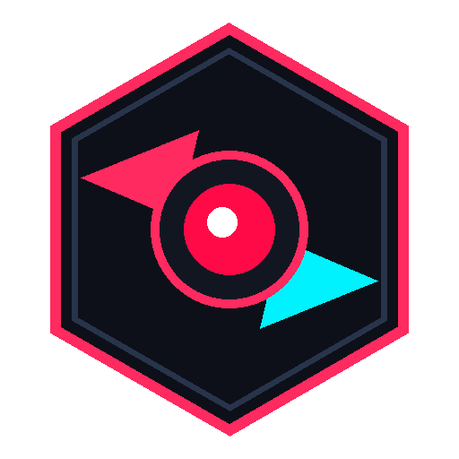

<p align="center">
  
</p>

<h1 align="center">STAR SCREAM</h1>

<p align="center">
  <b>High-Performance, Low-Latency PC Screen & Dual-Audio Recorder for Windows.</b><br>
  <i>Designed to be faster, cleaner, and dramatically easier than OBS.</i>
</p>

<p align="center">
  
  
  
  
</p>

---

## ⚡ Why STAR SCREAM?

OBS Studio is powerful, but for everyday gamers, content creators, and developers, it's cluttered with complex scenes, canvas transforms, confusing nested audio routing, and manual encoder settings.

**STAR SCREAM** delivers zero-friction screen and audio capture:
- **1-Click Recording:** Large glowing Start / Stop control with instant file saving.
- **Hardware Acceleration:** Native NVIDIA NVENC (`h264_nvenc`) GPU encoding for smooth 60–120 FPS recording with virtually zero CPU load.
- **Dual-Channel Audio Mixer:**
  - 🔊 **System Audio** (Desktop, Games, Discord, YouTube) captured directly via WASAPI loopback without virtual audio cables.
  - 🎙️ **Microphone** (Voice input) with independent volume controls and glowing real-time VU audio meters.
- **Custom Resolutions:** Native (Original), 4K UHD (`3840x2160`), 2K QHD (`2560x1440`), 1080p FHD (`1920x1080`), 720p HD (`1280x720`), and 480p SD.
- **Multi-Container Formats:**
  - `MP4 (Universal)`: Works seamlessly in editing suites, video players, and web browsers.
  - `MKV (Stream Safe / Crash Proof)`: Immune to file corruption if PC shuts down or power fails mid-recording.
  - `MOV (QuickTime / Pro Quality)`: For high-end video editing workflows.
  - `WEBM (Web Optimized)`: VP9 + Opus web standard.
- **Quality Bitrate Presets:** Ultra (25 Mbps), High (12 Mbps), Balanced (6 Mbps), Economy (3 Mbps).
- **Global Hotkeys:**
  - <kbd>F9</kbd> &rarr; Start / Stop Recording (works from inside full-screen games)
  - <kbd>F10</kbd> &rarr; Pause / Resume Recording
- **Recordings Vault:** Integrated in-app gallery with file sizes, instant play preview, and folder opening.

---

## 🚀 Quick Start

### Option 1: Standalone Windows App (No Python Required)
1. Download the release package or run `STARSCREAM.exe` from `dist/STARSCREAM/STARSCREAM.exe`.
2. Double-click to launch — FFmpeg is pre-bundled!

### Option 2: Run from Source
```bash
git clone https://github.com/ZedScript/STARSCREAM.git
cd STARSCREAM
pip install -r requirements.txt
python main.py
```

---

## 🛠️ Tech Stack & Architecture

- **UI Framework:** PySide6 (Qt for Python) with Dark Obsidian & Cyberpunk theme styling.
- **Display Capture:** Fast screen grabbing pipeline with thread-desktop session attachment.
- **Audio Capture:** WASAPI loopback audio stream mixing via `soundcard` & `numpy`.
- **Encoding Backend:** FFmpeg with NVIDIA NVENC hardware acceleration.
- **Hotkeys:** Low-level Windows global keyboard hooks via `keyboard`.

---

## 📜 License

This project is licensed under the [MIT License](LICENSE).
